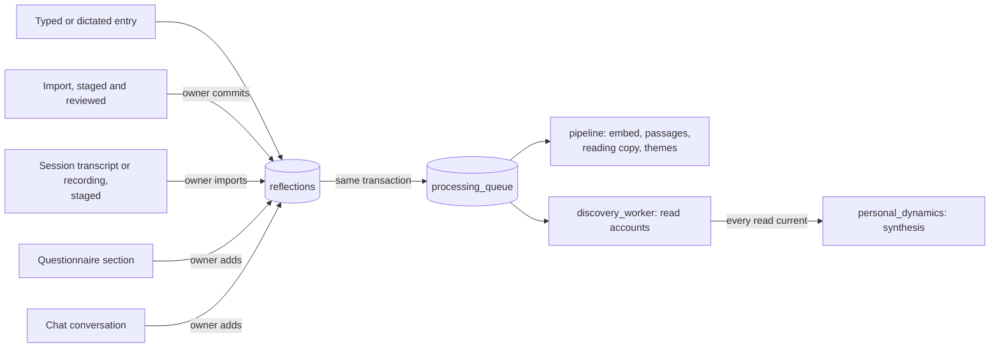
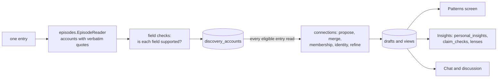

# IRIS architecture

How IRIS is built as it stands. Domain words and the rules behind them are in
[CONTEXT.md](CONTEXT.md); why each part is the way it is, in [docs/adr](docs/adr/README.md);
a guided route through the code, in [EXPLORATION_GUIDE.md](EXPLORATION_GUIDE.md); what to do
when a health check fails, in [docs/runbooks](docs/runbooks/README.md).

---

## 1. Shape

One Python process, one PostgreSQL database, one owner.

```
scripts/serve_iris.py  (one process, three doors — agent/mobile_auth.py)
  ├── 127.0.0.1:8000    the API (iris_api.py) and the built React app (frontend/)
  ├── 127.0.0.1:8001    the tailnet door, for `tailscale serve` only (ADR-0022)
  ├── private-LAN:8765  pinned-TLS door for the paired Android app (opt-in, ADR-0018/0019)
  └── agent/            everything else
        └── PostgreSQL 18 + pgvector
```

- **Single owner, no accounts.** The loopback door trusts the machine. The tailnet
  door admits only the owner's Tailscale login; the phone door only its paired
  bearer. Place coordinates, Timeline imports and every `/api/observatory/` route
  answer on loopback only (ADR-0001, 0018, 0022).
- **One datastore.** Embeddings are rows: `embeddings(source_type, source_id,
  model_name, vector(1536))`, so a nearest-neighbour search carries
  `WHERE user_id = …` in the same statement (ADR-0002). There is no approximate
  vector index: every search is an exact scan, a few milliseconds at this size.
  The IVFFlat indexes of the first schema compared about one memory in a hundred
  and were dropped (migration 0052).
- **Models.** Chat on `OPENAI_MODEL`; reading, synthesis and checks on the cheaper
  `OPENAI_WORKER_MODEL`, on the Flex tier; `text-embedding-3-small` for vectors;
  `gpt-4o-transcribe` for voice notes; `gpt-4o-transcribe-diarize` to tell a
  session's speakers apart; local Whisper large-v3 for a session's words (ADR-0030);
  `gpt-4o-mini-tts` for IRIS's voice (ADR-0025). The owner's records go to a model
  only after the owner's click, with the cost shown first.

## 2. Subsystems

| Subsystem | What it does | Modules (`agent/` unless shown) | Decisions |
|---|---|---|---|
| Journal | Write, edit, date and delete entries; daily check-ins | `trackers/reflections.py`, `journal_entry.py`, `database.py`, `markdown_text.py`, `prompt_labels.py` | 0006, 0010 |
| Importing | Stage exports and voice journals for review before anything is stored | `importing/*`, `transcription.py` | 0013 |
| Therapy sessions | Import a transcript or a recording; only the owner's turns are evidence | `sessions.py`, `session_imports.py`, `session_voices.py`, `local_whisper.py`, `session_cleanup.py`, `scripts/whisper_words.py` | 0028, 0030 |
| Questionnaire | Answer the baseline questionnaire by form or interview; suggestions from the owner's writing | `questionnaire.py`, `questionnaire_interview.py`, `questionnaire_suggest.py`, `questionnaire_context.py` | 0029 |
| Ingest queue | Durable jobs, written in the same transaction as their source | `work_queue.py`, `pipeline.py` | 0011 |
| Recall | Embeddings, passages for long entries and sessions, reading copies | `pipeline.py`, `entry_passages.py`, `readable.py` | 0031 |
| Patterns | Read accounts from each entry, then find recurring context–response dynamics | `discovery_worker.py`, `episodes.py`, `dynamics.py`, `connections.py`, `discovery.py`, `discovery_memo.py`, `field_support.py`, `reading_version.py`, `interpretation_version.py` | 0027 and later |
| Insights | Tentative claims from checked dynamics; optional process lenses; discussing one in chat | `personal_patterns.py`, `personal_insights.py`, `claim_checks.py`, `library.py`, `lens_matching.py`, `evidence_ref.py`, `discussion.py` | 0023, 0027 |
| Ideas | The owner's positions, backed by dated quotes, as a typed graph | `ideas/*` | 0021, 0026 |
| Chat | The companion: context, recall, streaming replies, talking, history | `core.py`, `memory.py`, `intelligence.py`, `approved_context.py`, `chat_evidence.py`, `voice.py`, `prompts/system_prompt.py` | 0020, 0025, 0032, 0033 |
| Older engines | Themes and seven measures, behind one admission policy | `persistence.py`, `comparison.py`, `trajectory.py`, `tension.py`, `resolution.py`, `leverage.py`, `decision_impact.py`, `lifelong.py`, `pipeline_orchestrator.py`, `confidence.py`, `conflict.py`, `conflicts.py`, `coverage.py`, `prioritization.py`, `narrative.py`, `narrative_policy.py`, `narrative_templates.py`, `insights_service.py`, `evidence.py`, `explanation.py`, `analysis_cache.py`, `constructs.py`, `observations.py` | 0003, 0005, 0007, 0009, 0014–0016 |
| Weekly letter | A letter about the week, held to the same rules | `review_letter.py` | 0007 |
| Decisions | A decision journal, written when a decision is made | `decisions.py` | — |
| Habits | Habits and completions | `trackers/habits.py` | 0003 |
| Body and days | Phone readings, places, measured days, day comparisons | `sensors/*`, `days/*`, `day_differences.py` | 0017, 0024 |
| Access | The three doors and who may use each | `mobile_auth.py`, `scripts/serve_iris.py` | 0001, 0018, 0019, 0022 |
| Observability | Traces, logs and samples; the Observatory | `observability/*` | — |
| Doctor | Checkable promises about the system, for agents | `doctor/*`, `docs/runbooks/` | — |
| Schema | Forward-only, checksummed migrations | `migrations.py`, `migrations/` | 0012 |
| Support | Settings, constants, logging, time, preferences, evaluation helpers | `config.py`, `constants.py`, `logging_config.py`, `timeutils.py`, `preferences.py`, `reference_evaluation.py`, `eval_copies.py` | 0006 |

## 3. Writing in



Everything the owner contributes ends as a row in `reflections`. Its `source` says
where it came from (`app`, `import`, `voice`, `session`, `questionnaire`, `chat`) and
`content_format` how to read it (`plain`, `markdown`, `session`). A session, a
questionnaire answer and an added chat share the session format: a front-matter block
naming the owner and the other speaker, then one paragraph per turn. **Only the
owner's turns are evidence**; the therapist's, the question's and IRIS's turns are
context (ADR-0028, 0029, 0032).

Nothing is stored or sent before the owner looks. Imports, sessions and questionnaire
drafts wait in staging tables (`import_items`, `session_imports`,
`questionnaire_answers`); adding a chat is a click under the composer.

The queue (`processing_queue`) is written in the same transaction as its source, so an
entry and its job exist together or not at all (ADR-0011). One worker thread drains it.
Job kinds: `reflection`, `message` and `habit` (embedding and themes, `pipeline.py`);
`discovery` (reading one entry); `personal_dynamics` (synthesis across the archive);
`transcription` and `session_voices` (not evidence). A failed job retries on a widening
backoff; one that fails every retry stays with its `last_error`, which begins with the
kind of failure.

## 4. Processing an entry

`pipeline.run_processing_pipeline` reads the row back by its id, then:

- **Journal entries:** embed the text without a journaling tool's prompt labels; cut an
  entry of over 250 words into passages of whole sentences, each embedded on its own
  (`entry_passages.py`), so chat recalls the part that matched; match the entry to
  themes (section 8).
- **Dictated entries** get a reading copy: the same words with punctuation put in,
  checked word for word (`readable.py`), cleared by any edit. The reader and the
  passages use the copy; every quote resolves back to the entry's own text (ADR-0031).
- **Sessions and questionnaire answers** are cut into passages of whole turns, each line
  naming its speaker. A non-English session's passages also get a vector of their English
  translation, so an English question finds a Polish passage; chat still shows the words
  as said. Sessions are not theme occurrences. An added chat gets no passages: its
  messages are recalled one by one already.

## 5. Patterns and insights



- **Reading** (`discovery_worker.py`, `episodes.py`): each eligible entry is read once per
  revision into accounts (events, self-reports, intentions, hypotheticals) with actor,
  situation, response and optional feeling, concern, explanation and outcomes. Every
  field must be quoted from the source, and is kept only if an independent check finds
  its passage supports it (`connections.check_account_fields`). A long session is read
  25 turns at a time. Accounts returned twice are kept once. A reason is recorded only
  when the owner gave one.
- **Synthesis** (`connections.py`, `discovery.py`): once every read is current, one
  `personal_dynamics` job proposes recurring context–response definitions, merges
  equivalents, checks each account's membership, groups retellings of one event, and
  refines. Verdicts already paid for are remembered (`discovery_memo.py`); an update adds
  at most 5 new definitions, of 24 at most. Any edit, deletion or re-read invalidates the
  drafts and the next run rebuilds. A full rebuild is hundreds of sequential Flex calls,
  an hour or more, stored only when it ends: **a restart throws it away**
  (`python -m agent.doctor --can-restart`).
- **Insights** (`personal_insights.py`, `claim_checks.py`): tentative function,
  difference or shared-concern claims over a selected range, each with supporting,
  contrary and unknown accounts, and clause-level checks against the sources.
  Twenty-four process lenses (`library.py`) may annotate a dynamic after it is found
  (`lens_matching.py`); they never classify the owner.
- **Discussion** (`evidence_ref.py`, `discussion.py`): a pattern or insight opened in chat
  carries a snapshot, re-verified before the message is sent.

## 6. Ideas

`agent/ideas/` reads entries only when the owner asks ("Read everything" or "Read what's
new", cost first), proposes positions with dated verbatim quotes, and links them into a
typed graph: supports, contradicts, refines, depends on, same meaning, applies. Quotes for
an idea the owner already holds are added automatically; new ideas wait in Review. A
critique of one idea is labelled IRIS's and never read back as the owner's writing
(ADR-0021, 0026).

## 7. Chat

`core.PersonalAICompanion` builds each turn's context from:

| Section | From |
|---|---|
| Today | the date, so "last week" is not a guess |
| Relevant long-term memory | an exact search over entries (long ones by passage), session passages, the owner's chat messages and habit notes, each shown with its kind, date and speaker |
| Baseline questionnaire | how many questions are answered; the three answers most related to the message, or every answer when the owner asks about the questionnaire |
| Earlier conversations | excerpts from other chats |
| Recent journal entries | the five most recently written; never questionnaire answers or added chats |
| Habits and streaks | today's habits |
| What they have approved | confirmed ideas and links, insights and patterns the owner said ring true, the decision journal, accepted phone readings (`approved_context.py`) |
| Observed patterns | the older engines' admitted findings (section 8) |

How to use it is in `prompts/system_prompt.py`: personal claims grounded, interpretations
labelled, only owner turns quoted as the owner's, one open question at a time to keep the
conversation going. Replies stream; a failure is never stored as IRIS's reply. The screen
reopens the conversation last written in, lists earlier ones, and starts a new one on
request (ADR-0033). Talk mode wraps the same turn in speech in and out (`voice.py`,
ADR-0025). A conversation is evidence only if the owner adds it (ADR-0032).

## 8. The older analytical engines

Still running, for chat's "observed patterns" section and the weekly letter.

| Engine | Question | Method |
|---|---|---|
| Persistence | What keeps appearing? | Cosine matching, then complete-linkage clustering on what differs between entries, with the owner's shared voice removed (ADR-0014) |
| Trajectory | What is changing? | Weighted regression on frequency |
| Tension | What co-exists uneasily? | Co-occurrence with divergent trends |
| Resolution | What settled or came back? | Recent against baseline windows |
| Leverage | What tends to precede? | Directional lift |
| Decision impact | What tends to follow? | Sequence analysis around decision anchors |
| Lifelong | What holds across years? | The same occurrences counted over the whole span |

A cluster needs 5 occurrences to be a theme. Reading on request (`observations.py`) can
propose constructs; nothing is measured until the owner confirms one (ADR-0015, 0016).

**Admission** (`pipeline_orchestrator.py`, ADR-0007): coverage, enablement, confidence,
conflict suppression, then ranking. Coverage withholds a finding about the present unless
3 of the last 21 days were written in. Confidence weights evidence by source (reflection
1.0, habit with notes 0.8, bare tick 0.5, sensor types 0.3–0.6). Chat keeps one finding per
pattern and cuts to the owner's `max_items`; every suppression is recorded with its
reason. The owner's `min_confidence`, `max_items` and enabled engines are read from
`user_preferences` on every analysis.

**Narrative firewall:** findings are rendered by fixed templates
(`narrative_templates.py`) and checked against a forbidden lexicon (`caused`, `should`,
`means`, `because`…). A finding that cannot be phrased neutrally is dropped, not softened.

## 9. Body and days

The Android app's foreground service buffers Pixel readings and permitted Health Connect
records and sends them to the phone door in batches (ADR-0017). A batch is staged until
the owner confirms it on the Sensors screen; only then does it become
`sensor_observations`, and only readings linked to a theme count as occurrences. Named
places keep their coordinates on the laptop (`days/places.py`). Confirmed readings build
one row of measured facts per day (`days/features.py`); day comparisons are conservative
differences between measured days and check-ins (`day_differences.py`, ADR-0024).

## 10. Observability and the doctor

Every request, query, model call and queue job is a span in `obs_spans`; logs go to
`obs_logs`, process and database samples to `obs_samples`, all kept 7 days. A quick,
successful database step is stored without the rows it returned. The Observatory
(`/observatory`, loopback only) shows health over the last minutes, traces, the queue,
the database and model spend.

The doctor (`python -m agent.doctor`) checks what errors never show: whether jobs and the
pattern update are moving; whether the data promises hold (everything embedded and read,
every quote found word for word, no orphaned vectors, passages and reading copies
current, the docs naming every module); and whether quality holds (search against an
exact computation, chat's context complete). Each run is stored in `health_checks` and the
report leads with what changed. Every check names a runbook in `docs/runbooks/`.

## 11. Failure behaviour

- **PostgreSQL unreachable:** the pool is built lazily, so the process starts and health
  reports degraded.
- **OpenAI unreachable:** embedding retries transient errors with backoff; beyond that the
  job stays queued and retries later, so an entry written during an outage becomes
  evidence when it clears. Chat failures raise and are shown as failures.
- **A reading or an engine fails:** it is logged and the job retried or skipped; the entry
  itself is never lost.

## 12. Lifecycle

Run under systemd on one machine (`scripts/iris.service.example`). The schema is owned by
`migrations/NNNN_*.sql`, applied in order at startup, each in one transaction and recorded
with its checksum in `schema_migrations`; editing an applied migration is an error, so fix
forward (ADR-0012). `tests/schema_snapshot.json` turns any schema change into a reviewable
diff. Back up with `scripts/backup_db.py` before a migration or a data change: it leaves out
the Observatory's rows, so a backup is tens of megabytes.

## 13. How it got here

- **January 2026:** FAISS and ChromaDB replaced by pgvector.
- **September:** Neo4j removed (it was write-only); one admission policy for chat and the
  screen (ADR-0007); a durable queue (ADR-0011); imports staged for review (ADR-0013);
  themes compared on what differs (ADR-0014); constructs read on request and confirmed by
  the owner (ADR-0015, 0016); phone and sensors (ADR-0017 to 0019); ideas (ADR-0021);
  Tailscale (ADR-0022).
- **October:** writing-derived Patterns and Insights moved to source-checked personal
  dynamics (ADR-0027 and its successors); therapy sessions (ADR-0028); the questionnaire
  (ADR-0029); local Whisper (ADR-0030); reading copies and passages (ADR-0031); chats as
  evidence (ADR-0032); chat history (ADR-0033); exact memory search (migration 0052); the
  doctor (migration 0053).
